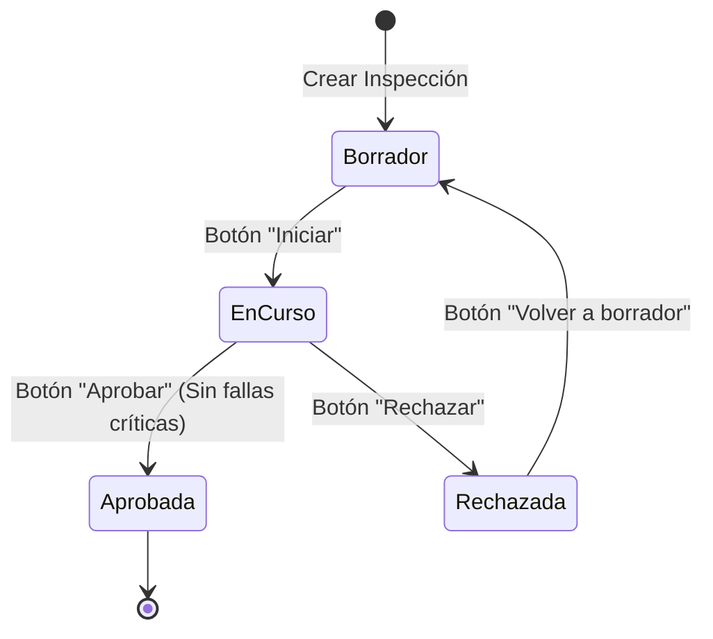

# Manual de Usuario: Inspecciones de Flota (`fleet_inspection`)

Este manual describe el funcionamiento, flujo operativo y buenas prácticas del módulo **fleet_inspection** en Odoo 17, utilizado para la auditoría técnica periódica, control de checklist preventivo y evaluación del estado operativo de los vehículos de la empresa.

---

## 1. Roles y Permisos de Seguridad

El módulo cuenta con dos perfiles de usuario dentro del menú **Flota**:

| Rol | Grupo de Seguridad | Atribuciones y Permisos |
| :--- | :--- | :--- |
| **Inspector de Flota** | `group_fleet_inspection_user` | Puede consultar vehículos, crear inspecciones en borrador, iniciarlas y evaluar los puntos del checklist (conforme/fallido) agregando observaciones y kilometraje. |
| **Responsable / Gerente de Flota** | `group_fleet_inspection_manager` | Control total. Puede configurar el catálogo de tipos de vehículo y el maestro de puntos de checklist (incluyendo la criticidad de fallas). Es el único facultado para **Aprobar**, **Rechazar** o **Reabrir** inspecciones. |

---

## 2. Configuración Previa del Sistema

Antes de iniciar inspecciones operativas, el Responsable de Flota debe validar o ajustar las plantillas de revisión:

### A. Tipos de Vehículo de Inspección
1. Navegue a **Flota > Configuración > Tipos de vehículo de inspección**.
2. Puede crear o editar los tipos disponibles (ej. *Automóvil*, *Camión de Carga*, *Motocicleta*).
3. Cada tipo posee un nombre descriptivo y un código identificador único.

### B. Puntos del Checklist de Inspección
1. Navegue a **Flota > Configuración > Puntos del checklist**.
2. Presione **Nuevo** para agregar los elementos que los inspectores deben auditar (ej. *Nivel de Aceite*, *Frenos y Pastillas*, *Luces y Faros*, *Extintor de Incendios*, *Presión de Neumáticos*).
3. **Casilla "Crítico":** 
   > [!IMPORTANT]
   > Si marca un punto como **Crítico**, cualquier vehículo que repruebe dicho punto no podrá ser aprobado para circular por el Responsable de Flota hasta que se repare.

---

## 3. Flujo de Vida de una Inspección

---

## 4. Guía Operativa Paso a Paso

### Paso 1: Registro de la Inspección (Inspector)
1. Navegue a **Flota > Inspecciones > Inspecciones**.
2. Haga clic en **Nuevo**.
3. Complete los datos de cabecera:
   - **Vehículo:** Seleccione la unidad a evaluar (ej. *Toyota Hilux - Placas AB123CD*).
   - **Tipo de vehículo:** Se completará automáticamente según el vehículo o podrá seleccionarse manualmente.
   - **Kilometraje (Odómetro):** Ingrese la lectura actual del tacómetro del vehículo (debe ser mayor o igual a 0).
   - **Inspector:** Por defecto, el usuario conectado.
   - **Fecha:** Fecha de realización de la prueba técnica.
4. Al guardar el registro, el sistema poblará automáticamente en la pestaña **Checklist** todos los puntos de verificación activos del sistema.
5. El registro queda en estado inicial **Borrador** con número correlativo (ej. `INSP/2026/00001`).

---

### Paso 2: Iniciar la Inspección y Evaluar el Checklist
1. Presione el botón **Iniciar** en la barra superior. El estado pasará a **En curso**.
2. El inspector examina físicamente la unidad y califica cada elemento en la tabla inferior:
   - **Resultado:**
     - `Pasa` (Conforme): El componente cumple con los estándares operativos.
     - `Falla` (No Conforme): El componente presenta averías, desgaste excesivo o anomalías. Se resaltará visualmente en color rojo.
     - `N/A` (No Aplica): El vehículo no cuenta con dicho componente.
   - **Comentarios:** Espacio para describir el hallazgo (ej. *Pastillas de freno delanteras al 20% de vida útil*).
3. En la pestaña **Observaciones**, puede redactar un dictamen general sobre el estado del vehículo.

---

### Paso 3: Resolución de la Inspección (Responsable de Flota)

Una vez completada la revisión en campo, el Gerente o Responsable de Flota revisa los resultados y toma una decisión:

#### Caso A: Aprobar Inspección
- El responsable presiona el botón **Aprobar**.
- **Validaciones Automáticas del Sistema:**
  1. *Puntos Incompletos:* El sistema no permitirá aprobar si existen puntos sin resultado seleccionado ("Faltan puntos por revisar").
  2. *Fallas Críticas:* Si algún punto marcado como **Crítico** tiene resultado `Falla` (por ejemplo: *Frenos y Pastillas* o *Neumáticos Delanteros*), el sistema bloqueará la aprobación mostrando una alerta clara:
     > *"No se puede aprobar: fallaron puntos críticos (Frenos y Pastillas)."*
- Si la unidad está en condiciones seguras, pasará a estado **Aprobada** (indicador verde).

#### Caso B: Rechazar Inspección
- Si el vehículo no cumple las condiciones mínimas operativas, el responsable presiona **Rechazar**.
- El vehículo pasa a estado **Rechazada** (indicador rojo).
- Una vez corregidos los desperfectos mecánicos en taller, el responsable puede presionar **Volver a borrador** para habilitar una nueva verificación sin perder la trazabilidad.

---

## 5. Control de Inspecciones Vencidas o Retrasadas

El sistema incorpora un mecanismo de alerta automática para evitar que inspecciones queden abandonadas o incompletas:
- Si una inspección permanece más de **7 días en estado "En curso"**, una tarea programada del sistema (cron) la marcará automáticamente como **Vencida**.
- En el formulario aparecerá una notificación visual destacada:
  > *"Esta inspección lleva más de 7 días en curso."*
- Simultáneamente, el sistema creará una **Actividad pendiente (To-do)** asignada al inspector responsable en su bandeja de actividades de Odoo para recordarle concluir la revisión.

---

## 6. Reporte Técnico Impreso (PDF)

Para entregar un soporte físico al conductor, archivar en la carpeta del vehículo o presentar a las autoridades de transporte:

1. Ingrese a la inspección de vehículo correspondiente.
2. Haga clic en el botón superior **Imprimir** y seleccione **Inspección**.
3. Se generará un informe técnico en PDF con el formato corporativo:
   - Identificación del vehículo, modelo y número de placa.
   - Odómetro y fecha de ejecución.
   - Inspector responsable y dictamen final de estado (Aprobada / Rechazada).
   - Matriz detallada de cada punto del checklist con su resultado individual y comentarios técnicos.
   - Cuadro final de observaciones generales.

