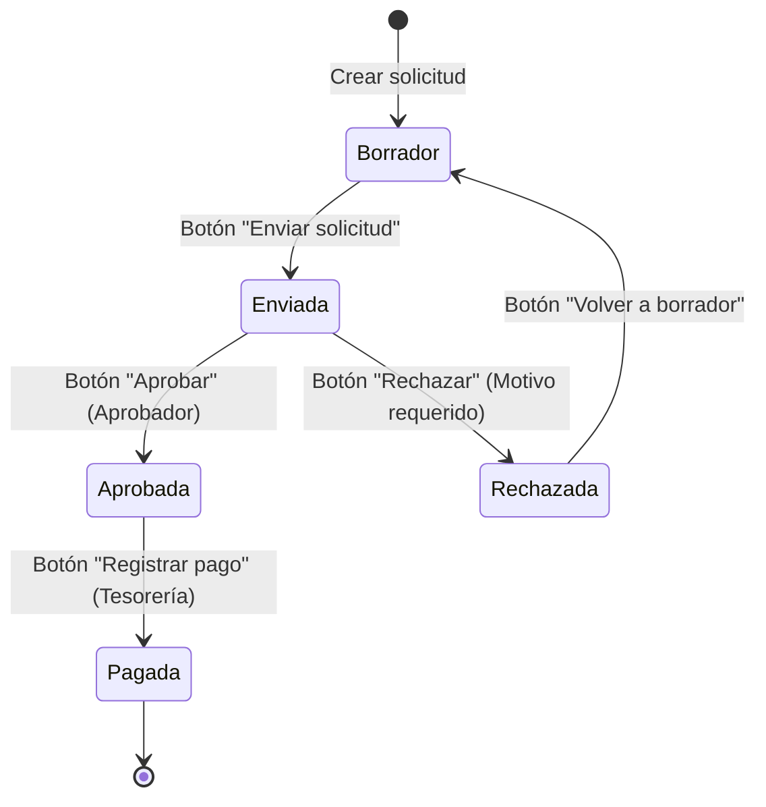

# Manual de Usuario: Solicitudes de Pago (`payment_request`)

Este manual describe el funcionamiento funcional y operativo del módulo de **Solicitudes de Pago a Proveedores**, cubriendo desde la parametrización de niveles de aprobación hasta la emisión contable del desembolso y el reporte impreso de auditoría.

---

## 1. Roles y Permisos de Acceso

El sistema clasifica las atribuciones en tres niveles de seguridad para garantizar la segregación de funciones:

| Rol | Grupo Técnico | Responsabilidades y Acceso |
| :--- | :--- | :--- |
| **Solicitante** | `group_payment_request_user` | Crea solicitudes de pago en borrador y las remite a aprobación. **Regla de privacidad:** Solo puede ver y listar sus propias solicitudes. |
| **Aprobador** | `group_payment_request_approver` | Visualiza todas las solicitudes de la compañía. Configura los rangos y niveles de aprobación. Puede aprobar o rechazar solicitudes (con justificación obligatoria). |
| **Tesorería** | `group_payment_request_treasury` | Acceso a solicitudes aprobadas. Habilitado para ejecutar el desembolso financiero mediante el asistente contable, gestionar tasas de cambio y registrar el pago oficial (`account.payment`). |

---

## 2. Configuración Inicial: Niveles de Aprobación

Antes de enviar solicitudes a aprobación, el Administrador o Responsable de Aprobación debe definir las matrices de autorización según el monto:

1. Ingrese a **Solicitudes de Pago > Configuración > Niveles de Aprobación**.
2. Haga clic en **Nuevo** y complete:
   - **Nombre del Nivel:** (Ej. *Nivel 1 - Compras Menores*, *Nivel 2 - Gerencia de Finanzas*).
   - **Monto Mínimo:** Umbral inferior (ej. `0.00`).
   - **Monto Máximo:** Umbral superior (ej. `500.00`). Para el nivel más alto sin límite, ingrese un valor techo como `999999999.00`.
   - **Moneda:** Moneda base del rango (ej. `USD` o `VES`).
   - **Usuario Aprobador:** Seleccione el usuario responsable de revisar y autorizar las solicitudes dentro de dicho rango.
3. Guarde el registro.

> [!NOTE]
> Cuando una solicitud se envía a aprobación, el sistema evalúa automáticamente el monto de la solicitud y le asigna el aprobador configurado para ese rango.

---

## 3. Ciclo de Vida de una Solicitud de Pago

---

## 4. Guía Operativa Paso a Paso

### Paso 1: Crear una Solicitud (Rol Solicitante)
1. Navegue a **Solicitudes de Pago > Solicitudes > Solicitudes de Pago**.
2. Haga clic en **Nuevo**.
3. Complete los campos obligatorios:
   - **Proveedor:** Seleccione la empresa o persona beneficiaria del pago.
   - **Monto:** Importe a cancelar.
   - **Moneda:** Seleccione la moneda de la obligación (ej. USD o VES).
   - **Concepto:** Detalle de forma clara el motivo del pago (ej. *Pago Factura #F-4589 por mantenimiento de servidores*).
   - **Fecha:** Fecha de registro o emisión del requerimiento.
4. El sistema asignará el estado **Borrador** y la numeración automática correlativa (ej. `SP/2026/00001`).

### Paso 2: Enviar a Aprobación
1. Desde el formulario de la solicitud, presione el botón **Enviar solicitud** (esquina superior izquierda).
2. El estado cambiará a **Enviada**.
3. El sistema buscará el nivel de aprobación correspondiente y asignará automáticamente el **Aprobador Asignado**.
4. En el panel inferior (**Chatter**), se registrará un mensaje de auditoría y se programará una actividad automática para el aprobador.

---

### Paso 3: Aprobación o Rechazo (Rol Aprobador)

#### Opción A: Aprobar la Solicitud
1. El aprobador asignado entra a **Solicitudes de Pago > Solicitudes de Pago** y localiza las solicitudes en estado *Enviadas / Por aprobar*.
2. Verifica los recaudos y presiona el botón **Aprobar**.
3. El estado pasa a **Aprobada**. Se registra automáticamente el usuario que aprobó y la marca de tiempo exacta (fecha y hora).

#### Opción B: Rechazar la Solicitud
1. Si la solicitud presenta inconsistencias o falta de soporte, presione el botón **Rechazar**.
2. Se desplegará un asistente emergente: **Rechazar Solicitud de Pago**.
3. Ingrese obligatoriamente el **Motivo de Rechazo** (ej. *Falta adjuntar factura con RIF válido*).
4. Presione **Rechazar Solicitud**.
5. El estado pasará a **Rechazada**. El motivo quedará registrado prominentemente en la parte superior del formulario y notificado al solicitante en el Chatter.
6. El solicitante puede presionar **Volver a borrador**, subsanar la observación y volver a enviarla.

---

### Paso 4: Desembolso y Registro de Pago (Rol Tesorería)

Una vez aprobada, el equipo de Tesorería toma control de la orden para efectuar la erogación de fondos:

1. Localice la solicitud en estado **Aprobada**.
2. Presione el botón **Registrar pago**.
3. Se abrirá el asistente **Registrar Pago de Solicitud**:
   - **Diario y Fecha:** Seleccione el diario de pago (ej. *Banco Mercantil*, *Caja Chica*, *Banco USD*).
   - **Manejo Multimoneda:** Si la moneda del diario difiere de la moneda de la solicitud (por ejemplo, solicitud en `USD` pero cancelada en `VES`), el sistema activará automáticamente los campos:
     - **Tasa de Cambio:** Ingrese o confirme la tasa de cambio aplicable.
     - **Monto de Desembolso:** Muestra el cálculo exacto a debitar de la cuenta contable.
   - **Referencia/Comunicación:** Texto de conciliación que viajará al asiento contable (ej. *Pago SP/2026/00001 - Transf #84920*).
4. Haga clic en **Confirmar y Generar Pago**.
5. **Resultado Inmediato:**
   - La solicitud pasa a estado **Pagada**.
   - Se crea el comprobante oficial de pago en el módulo contable (`account.payment`).
   - Se activa el **botón inteligente "Pago Contable"** en la parte superior derecha de la solicitud para consultar el comprobante y sus apuntes contables con un solo clic.

---

## 5. Reporte Impreso de Auditoría (PDF)

Para fines de archivo físico, auditoría interna o control fiscal:

1. Dentro de cualquier solicitud de pago, haga clic en el botón **Imprimir** (icono de impresora o menú superior) y seleccione **Solicitud de Pago**.
2. El sistema genera un documento PDF formal que incluye:
   - Encabezado con estado y código de solicitud.
   - Datos del proveedor, concepto y desglose de importes.
   - **Recuadro de Control de Aprobación:** Identificación de quién aprobó, cuándo y bajo qué nivel.
   - **Recuadro de Tesorería:** Referencia del comprobante contable generado, banco emisor y fecha de pago.
   - **Espacio para firmas físicas:** Solicitante, Aprobador y Tesorería.

---

## 6. Filtros y Búsquedas Útiles

En la vista de lista de Solicitudes de Pago dispone de filtros preconfigurados en la barra de búsqueda:
- **Mis solicitudes:** Filtra rápidamente las solicitudes donde el usuario activo es el solicitante.
- **Por aprobar asignadas a mí:** Bandeja de entrada para que cada aprobador atienda sus pendientes.
- **Aprobadas / Por pagar:** Bandeja de trabajo para el departamento de Tesorería.
- **Agrupadores:** Agrupe por Proveedor, Estado, Aprobador Asignado o Fecha/Mes.

